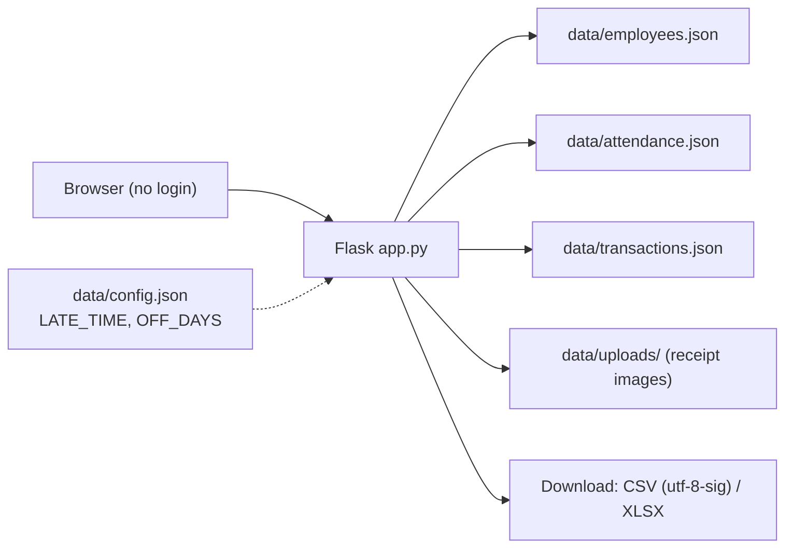
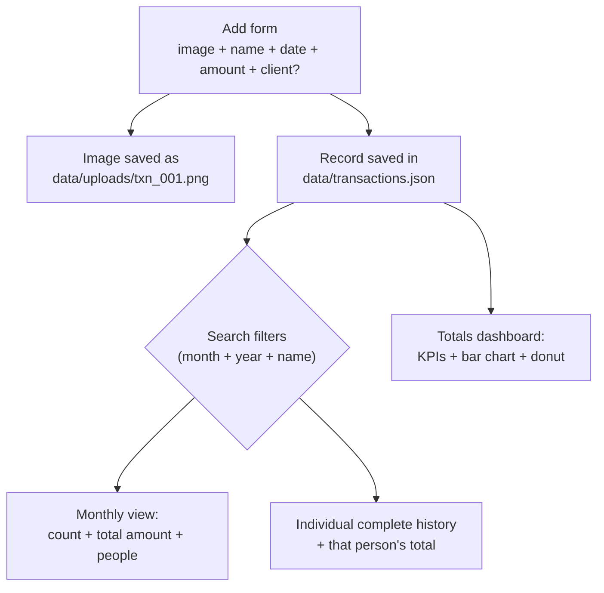
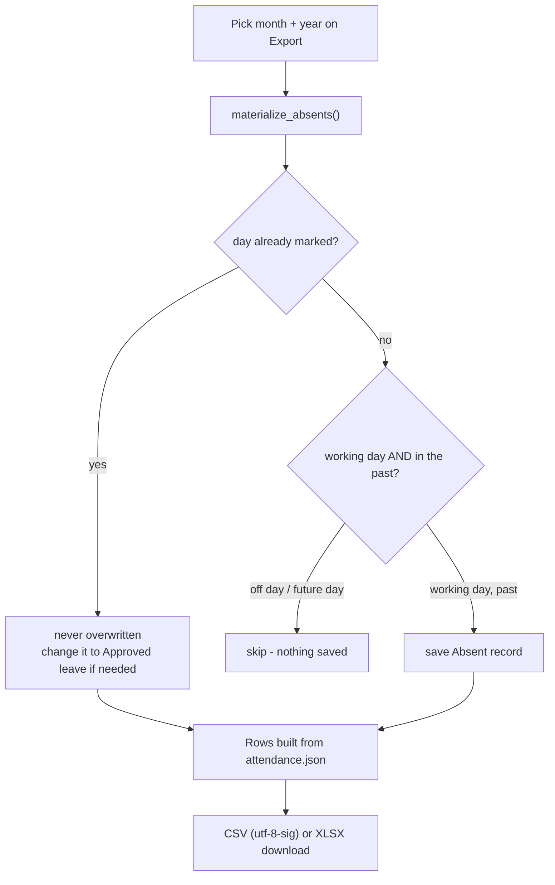

# HRMS

A small local HRMS: employees, attendance, **transactions with receipt images** and
monthly CSV/XLSX exports, plus a **Totals dashboard** with graphs.
No login, no database - all data lives in plain JSON files (images on disk).

## Install & run

```bash
pip install -r requirements.txt
python app.py
```

Or on Windows just double-click **`start.bat`** - it opens a shell, runs the app and keeps
the window open (close it when you are done).

Open http://127.0.0.1:5000 , make your changes, close the browser (and the app when done).
The `data/` folder is your permanent record - back it up.

## How it fits together



## Pages

| Page | What it does |
|------|--------------|
| **Home** | Counts (employees, attendance, transactions) + quick start. |
| **Employees** | Add employees (ID `emp_001`, `emp_002`... auto-generated). Department and designation are optional. `Mark ex` keeps the person out of active use but preserves all history; `Delete` removes the person **and** their attendance records (confirmation prompt). |
| **Attendance** | Pick employee + date (defaults to today) and a **day type**: *Worked* (enter arrival time + hours; status is automatic - **Present** at/before the late time, **Late** after), *Approved leave*, or *Absent*. Re-opening a date that has data shows an orange warning and prefills it. |
| **Transactions** | Save an **image/receipt + name + date + amount + client (optional)**. Search by **month + year** (see count, total amount and **how many people** transacted that month) or by **person for their complete history**. Delete removes the record and its image. |
| **Totals** | Dashboard: KPI cards (all-time amount, this month, people, count), a **bar chart** of the last 12 months, a **donut** of top people by amount and the recent transactions. |
| **Export** | Choose month + year, download the attendance CSV or XLSX. Opening this page also **saves** the auto-absents (see below). |
| **Import** | Upload a correctly formatted `.json` file to bulk add/update employees and attendance. Nothing is ever deleted by an import. |

## Transactions



Rules:

- **Image** is required; PNG / JPG / WEBP / GIF up to **8 MB**. The file is stored under a
  server-generated name (`txn_001.png`), never the original filename.
- **Client** is optional. Amount must be a positive number (no currency symbol is stored -
  the value is shown with thousand separators).
- Search filters combine: `month` + `year` + `name` (name is a case-insensitive substring).
  The summary cards always show **Transactions / Total amount / People** for the current
  search - "People" is the distinct number of names, so a month's card answers
  *"how many people transacted this month"*.
- Typing a person's name shows their **complete history** (all months) with their total;
  add a month filter to narrow it.
- `Delete` removes the JSON record **and** the image file (with confirmation).

## Totals dashboard

- **KPIs**: total amount (all time), this month's amount (+ how many transactions and
  people), distinct people / clients, transaction count.
- **Bar chart**: amounts per month for the last 12 months, current month highlighted.
- **Donut**: top 5 people by amount (+ "Others"), with percentages and amounts.
- **Recent**: the 5 newest transactions with thumbnails.
- Charts are hand-built (CSS bars + inline SVG) - no chart library, no internet needed.
- Empty state guides you to the Transactions page.

## Attendance: unmarked day = Absent (automatic)

When you open the **Export** page for a month, every **working day** you have not marked is
filled with a saved `Absent` record - so nobody can be missed just because you forgot a day.



- **Past days only** - future/current days are never guessed.
- **Off days are skipped** - default `["Saturday"]`, edit `OFF_DAYS` in `data/config.json`
  (e.g. `["Saturday", "Sunday"]`).
- **Ex employees**: only filled up to the last day they were marked in that month.
- **Not-yet-joined employees** (`added_on` is later) are not touched.

## The settings constants

`data/config.json`:

```json
{ "LATE_TIME": "22:00", "OFF_DAYS": ["Saturday"] }
```

- `LATE_TIME` - arrival after this time (24h clock) = status `Late`.
- `OFF_DAYS` - weekday names (English, as in `strftime("%A")`) never auto-marked absent.

## Export files (tested against Google Sheets)

- Columns: `Employee ID, Name, Department, Designation, Date, Status, Hours` - one row per
  attendance record of the selected month, sorted by date then employee.
- Statuses: `Present`, `Late`, `Absent`, `Leave` (approved leave).
- **CSV**: UTF-8 **with BOM**, comma separated, CRLF lines - Google Sheets and Excel detect
  the encoding correctly, so names with accents or commas don't get garbled.
- **XLSX**: bold dark-blue header, frozen header row, auto-filter, sensible column widths,
  colour-coded Status (green Present / yellow Late / red Absent / blue Leave). Dates are
  stored as plain `YYYY-MM-DD` text so Google Sheets never turns them into serial numbers.
- Empty month = no file, a message instead.
- To view on Google Drive: upload -> right-click -> **Open with > Google Sheets**.

## Data files (JSON source of truth)

`data/employees.json`

```json
{ "employees": [ { "id": "emp_001", "name": "Ali Khan", "department": "Operations",
                   "designation": "Supervisor", "active": true, "added_on": "2026-10-16" } ] }
```

`data/attendance.json` - keyed by employee, then by `YYYY-MM-DD`:

```json
{ "records": { "emp_001": { "2026-10-01": { "arrival": "09:00", "hours": 8, "status": "Present" } } } }
```

`data/transactions.json` + images in `data/uploads/`:

```json
{ "transactions": [
  { "id": "txn_001", "name": "Client A", "date": "2026-10-14",
    "amount": 1500.5, "client": "Acme Corp", "image": "txn_001.png" }
] }
```

All three JSON files are **local-only** (git-ignored) - they never get pushed to GitHub.

### Import file format

Both keys optional; existing ids/dates are updated, new ones added, missing fields default:

```json
{
  "employees": [
    { "id": "emp_001", "name": "Ali Khan", "department": "Operations",
      "designation": "Supervisor", "active": true }
  ],
  "attendance": {
    "emp_001": {
      "2026-10-01": { "arrival": "09:00", "hours": 8, "status": "Present" },
      "2026-10-02": { "arrival": "22:30", "hours": 8, "status": "Late" },
      "2026-10-03": { "arrival": "",      "hours": 0, "status": "Absent" },
      "2026-10-06": { "arrival": "",      "hours": 0, "status": "Leave" }
    }
  }
}
```

Rules: an employee without an `id` gets the next free one; an invalid/missing `status` is
recomputed from `arrival` vs `LATE_TIME`; `status` must be Present, Late, Absent or Leave;
unknown employee ids are skipped and reported. (Transactions are not part of import.)

## Theme

Dark-green direction used across every page:

| Swatch | Hex | Use |
|--------|-----|-----|
| Lime | `#9FDC56` | accent, buttons, active nav, Present, numbers |
| Pale | `#EAFFD2` | primary text, highlights |
| Coral | `#FF7366` | destructive actions, Absent |
| Blue | `#545FFF` | Leave, secondary chart colour |
| Base | `#161815` | background, text on accent |

Typography: *Neue Montreal* if installed, otherwise the system UI stack. Charts use the same
palette (bars in lime, current month in pale).

## Tests

```bash
python smoke_test.py
```

82 end-to-end checks against a temporary data folder (your real data is not touched).

## Not included (on purpose)

No login (local single-user tool), no network deployment hardening, no payrolls.
Transactions have no CSV/XLSX export yet - see `TODO.md` for the agreed future items.
